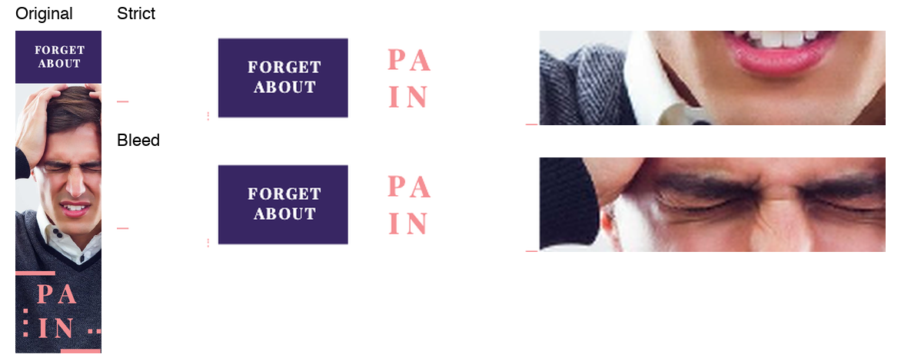
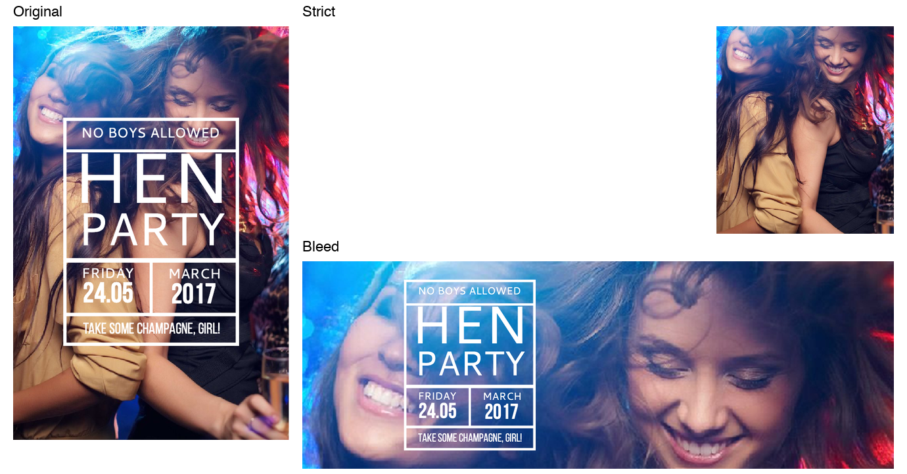
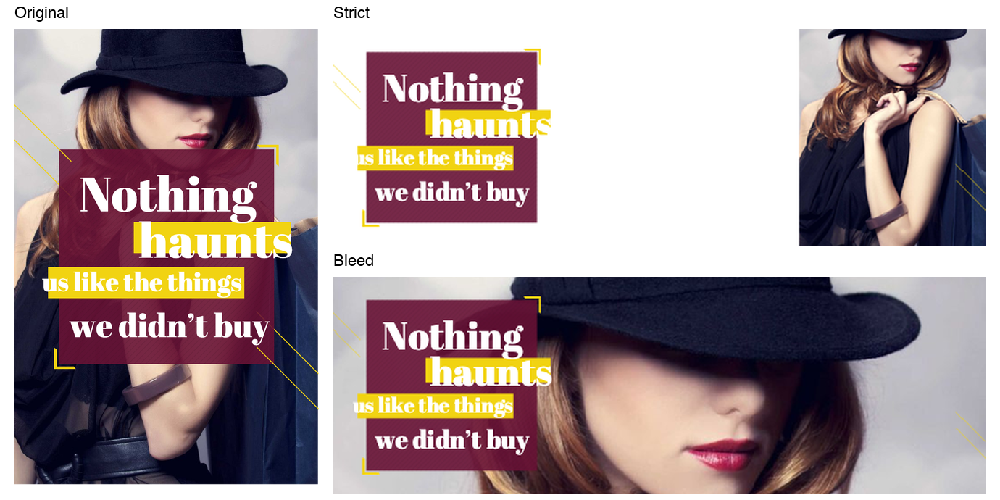
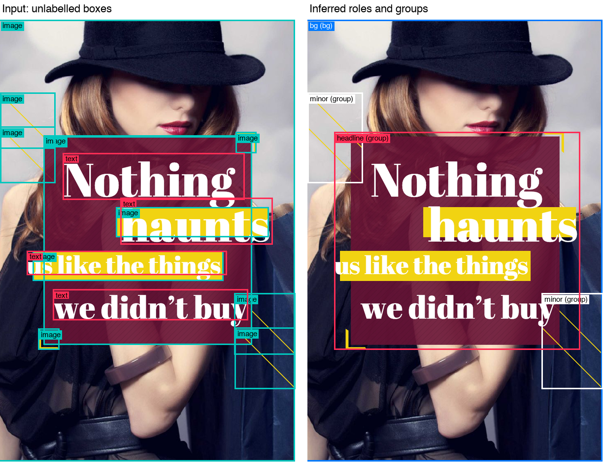
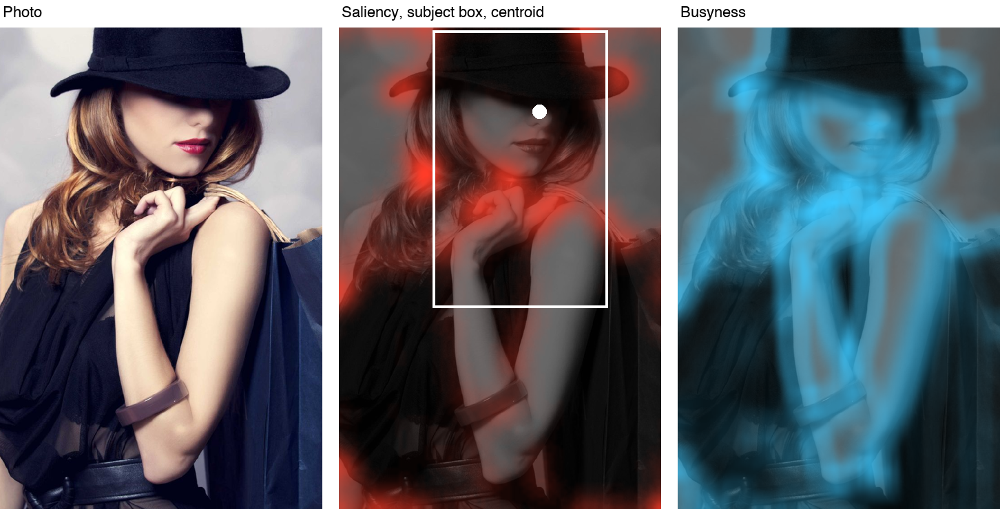
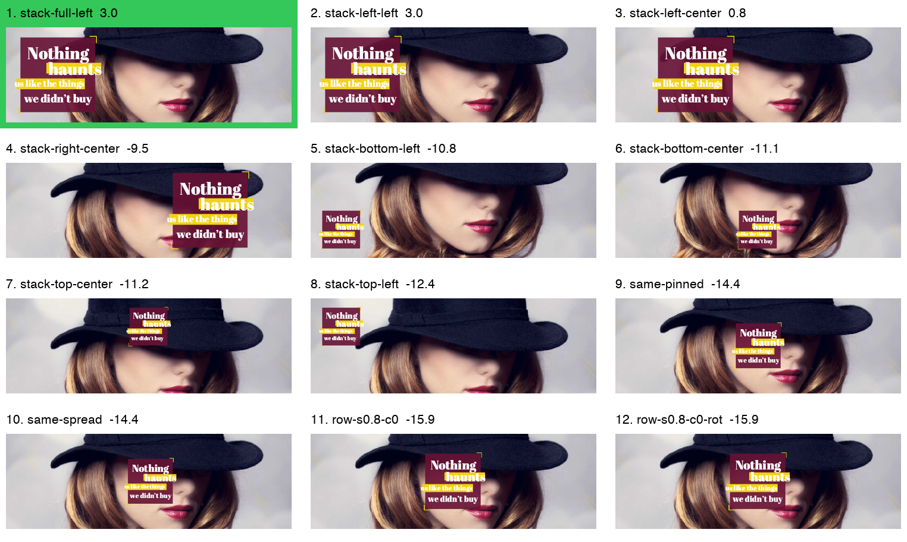
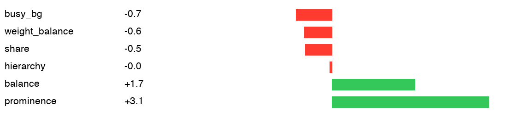
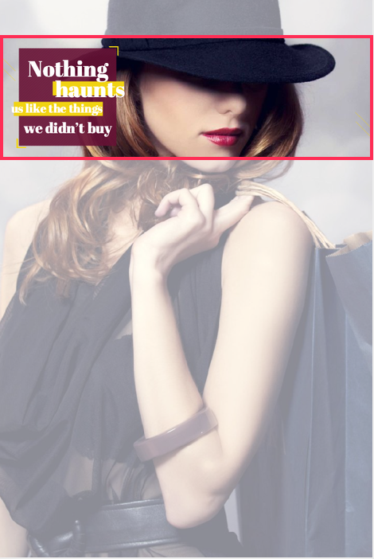
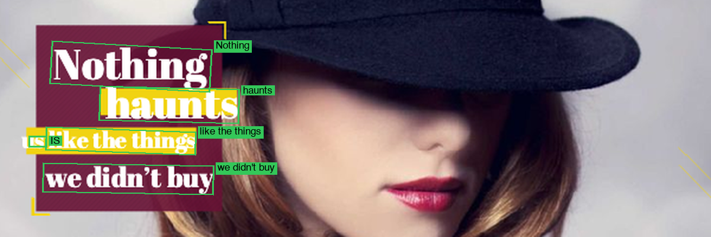

# CHAMELEON

**Resize a finished design to any canvas by rearranging it, not stretching it.**

Give it a design (text, images, shapes) and a new size. It returns the same
design with the same elements, words and pictures, repositioned and rescaled so
it still looks like the designer's work.

---

## Please read this first: the bleed toggle

**This engine has two modes, and one setting switches between them. If bleed is
allowed, please score it with bleed on. That is our best work.**

| | Strict (default) | Bleed (`CHAMELEON_BLEED=1`) |
|---|---|---|
| Element boxes | Stay on the canvas | May run past the edge, cut off by it |
| Photo crops | Centred only | Aimed at the subject |
| Designer's own bleed | Pulled inside | Kept |
| Structural self-check | Designed to pass | Prints `off-canvas` warnings on purpose |
| Aesthetics | Safe | **Our best results** |

**Strict is the default.** You get it by running the engine normally. Bleed only
turns on when you add `CHAMELEON_BLEED=1`:

| | Strict (default) | Bleed |
|---|---|---|
| Local | `.venv/bin/python -m engine.main` | `CHAMELEON_BLEED=1 .venv/bin/python -m engine.main` |
| Docker | the `docker run` command below | the same command with `-e CHAMELEON_BLEED=1` added |

Docker, strict (default):

```bash
docker run --rm --network none -v $(pwd)/input:/app/input -v $(pwd)/output:/app/output my-chameleon-engine
```

Docker, bleed:

```bash
docker run --rm --network none -e CHAMELEON_BLEED=1 -v $(pwd)/input:/app/input -v $(pwd)/output:/app/output my-chameleon-engine
```

Build the image first (see [Run it](#run-it)).

### How to tell which mode you ran

Bleed is off unless you set `CHAMELEON_BLEED=1`. Leaving it unset gives exactly
the same output as `CHAMELEON_BLEED=0`.

We ran the three sample designs through the Docker image, offline:

| Setting | Mode | Level 1 | Level 2 | Level 3 |
|---|---|---|---|---|
| Not set | Strict | OK | OK | OK |
| `CHAMELEON_BLEED=0` | Strict | OK | OK | OK |
| `CHAMELEON_BLEED=1` | Bleed | OK | 2 `off-canvas` warnings | OK |

- **OK** means the self-check found no problems.
- **The two warnings are expected, not errors.** Level 2 has two decorative circles that the designer ran off the edge. Bleed mode keeps them that way, so the self-check reports them. The run still finishes and writes its JSON and PNG.
- **Levels 1 and 3 come out identical in both modes.** Neither needs anything past the canvas edge. The modes differ on photo-heavy designs, shown below, not on these samples.

### Why there are two modes

We could not tell whether bleed is allowed. The rules say "nothing off-canvas",
but they do not say whether that covers an image that is cropped and
repositioned, and a designer does this all the time.

Jeffrey and Vlatko asked this at the Teams meeting around October 22. The lead
engineer, Ajit Kumar, gave us a vague answer on whether images could bleed when
cropped and repositioned. His guidance was to prioritize whatever looks good
and whatever a designer would do.

So we built for that guidance, and we also ship a safe default in case our
reading is wrong. The toggle is our answer to the ambiguity:

- **Strict is the default**, in case our subject-aimed cropping is not allowed.
- **If we misread the rules and bleed is allowed, please turn bleed on.**

### Why the bleed mode looks better

The output schema has no crop offset. An image with `fit: cover` is always
cropped around its centre. The only way to show a subject that is not in the
centre is to make the image box larger than the canvas and slide it, which lets
the canvas edge do the cropping. To the structural check, that is an element
off the canvas.

This matters most on photo-heavy designs, which is where we spent most of our
optimization. Bleed mode also keeps the designer's intent when elements were
meant to run off the edge, such as a large circle clipped by the frame. On the
large majority of Crello designs we ran, this engine looks significantly better
than our other engines.

### What bleed gets you

Three designs from our Crello test sets, resized in both modes.

**The subject stays in frame.** On a 728×90 strip, a centred crop lands on the
man's mouth. Bleed mode aims at his face and keeps his eyes, so the headache
that carries the "Forget about pain" message still reads.



**The photo becomes the design.** A tall photo can't fill a 3000×1055 banner
whole. Bleed mode does what a designer would: it pushes in on the two friends,
lets their hair and shoulders run off the edges, and floats the card over the
photo. Strict mode has to keep the picture on the canvas, so it shrinks into a
corner. The card's white type is left on bare white, where it disappears.



**A cinematic crop.** At 600×200, bleed mode lets the hat and shoulders run past
the frame and keeps the shaded eyes and red lips that make the design. The copy
block overlaps the photo, as in the original. In strict mode, the photo and copy
split apart with white between them.



### Measured results

The bleed version of this engine against our other engine, measured on
2026-10-30. Each cell shows distance to the designer's resize / words read by
OCR, and lower distance is better. These are fidelity and legibility numbers.
Aesthetics were judged by eye on side-by-side sheets.

| set | this engine | our other engine |
|---|---|---|
| challenging (`crello_hard`) | 0.543 / 90.5% | 0.674 / 83.0% |
| training split (`crello_train`) | 0.584 / 90.4% | 0.689 / 80.2% |
| validation split (`crello_val`) | 0.625 / 90.7% | 0.805 / 86.1% |
| first held-out (`crello_fresh`) | 0.461 / 93.3% | 0.560 / 84.4% |

---

## Run it

You need Python 3.11 (3.12 and 3.13 also work) and an internet connection for
the first run.

```bash
git clone https://github.com/PrompGibbons825/Adobe.git
cd Adobe
./setup.sh
```

This takes about a minute. It installs everything, downloads about 150 MB of
model files once, and resizes the three sample designs. Open the PNGs in
`output/` to see the results.

The first design takes about 30 seconds (one-time warm-up). After that, each
takes 1–2 seconds.

**Your own design:** put a task JSON in `input/` (format: see the samples and
`chameleon_design_schema_v0.9.json`), then run:

```bash
.venv/bin/python -m engine.main
```

**Docker (how it is scored).** This runs strict mode. To run bleed, use the command in the [toggle section](#please-read-this-first-the-bleed-toggle).

```bash
docker build --platform linux/amd64 -t my-chameleon-engine .
docker run --rm --network none -v $(pwd)/input:/app/input -v $(pwd)/output:/app/output my-chameleon-engine
```

**Something broke?**

| Problem | Fix |
|---|---|
| `rapidocr-onnxruntime` won't install on Python 3.13 | `./setup.sh` already handles it. Python 3.11 avoids it. |
| `CERTIFICATE_VERIFY_FAILED` downloading models | Re-run `./setup.sh`. It falls back to your system `curl`. |
| Output PNGs are plain labelled boxes | The renderer didn't install. Check `pip install` finished (it needs `git` and a network connection). |

Run with `CHAMELEON_DEBUG=1` to see every candidate layout and its score.

---

## How it works

The input is just boxes, fonts and asset names, with no labels. So the engine
first works out what everything is, then tries many layouts and picks the best.

1. **Analyze.** Work out each element's role (headline, logo, button, photo, badges, fine print, decoration) and which elements belong together. Read each photo (below).
2. **Propose.** Build 10–40 candidate layouts: refit the original, stack, split, panel, one row, columns, or, for extreme strips, turn the whole design.
3. **Finalize.** Crop background photos around the subject (never across eyes), place decoration, and enforce a minimum readable type size.
4. **Critique.** Score each candidate against our model of the judge's rubric. Then render the top ones and check with OCR that the headline and button still read.
5. **Build.** Output schema-valid JSON. In strict mode, a last pass (`engine/nobleed.py`) brings in anything still over the edge. Any error falls back to a plain proportional scale, so a run never crashes.

### How it reads a photo

All of this runs offline on CPU, in [`engine/saliency.py`](engine/saliency.py)
and [`engine/vision.py`](engine/vision.py).

| Signal | Method | What it decides |
|---|---|---|
| **Subject** | Spectral residual saliency map: whatever stands out from the image's smooth frequency curve | Where the crop aims, and what copy must not cover |
| **Busyness** | Local edge density | Where text can sit and still read: calm sky yes, foliage no |
| **Faces and eyes** | YuNet, with a Haar cascade as well | Crops never cut eyes, and cards never cover them |
| **Cut-outs** | The PNG's alpha channel is the object mask | Exact subject shape for transparent images |
| **Natural up** | CLIP ViT-B/32 | Whether a photo may turn with the design, and logo detection |
| **Legibility** | PP-OCRv4 via RapidOCR on the rendered result | Vetoes layouts whose headline or button no longer reads |

In bleed mode, the crop slides so the subject lands on a rule-of-thirds line
opposite the text, then searches for the best window. In strict mode the crop
cannot slide, so if eyes would be cut, the box narrows until the centred crop
reaches them.

Three rules shape everything:

- **Faithful first.** The designer's arrangement is kept unless a rebuilt layout is clearly better. The more extreme the size change, the more freedom to restructure.
- **Nothing invented.** Same element ids, same words, same pictures. Images are only cropped or scaled, never redrawn.
- **It has to read.** We check by rendering and running OCR, not just by arithmetic.

**[Read the in-depth walkthrough →](docs/HOW_IT_WORKS.md)**

---

## Tradeoffs we made

| Decision | Why | What it costs |
|---|---|---|
| **Strict by default, bleed behind a toggle** | The bleed rule is unclear, and strict is the safe reading. | The default is not our best-looking output. |
| **Classical analysis plus small offline models**, no generative or large model | Image regeneration is disqualifying, scoring is offline, and speed counts. Every choice is inspectable. | It can't "understand" a design like a person. Unusual designs can be misread. |
| **Try many layouts, let our critic choose** | No single template wins everywhere. | The critic is hand-tuned and can overfit. |
| **Restructure only for extreme shape changes** | A square can't become a 12:1 strip without rows or turned text, but an ordinary portrait↔landscape change should stay upright. | Strip layouts differ from the source, and the type is small. |
| **Crop or fit pictures, never stretch. Eyes come first.** | Distortion and a card across someone's eyes are the first things a judge notices. | Crops are sometimes more cautious than a designer's. |
| **Tiered critic and learned subject mask are built but off** | Not yet reliable. They flipped choices on unrelated designs. | We leave their gains unused for now. |

**[Read the full reasoning for each decision →](docs/TRADEOFFS.md)**

---

## Hackathon rules

| Rule | How we meet it |
|---|---|
| Same element ids, nothing added or removed | Every id returns once, checked by `self_check` in `main.py`. |
| Nothing off-canvas | Strict mode keeps boxes on the canvas. Bleed mode deliberately does not (see the top of this page). |
| Images in proportion, never regenerated | Crop or fit only. No generative model anywhere. |
| Text and font family fixed | Never rewritten. |
| Offline (`--network none`) | Models are in git, in the pip wheel, or fetched at Docker build time. |
| Public weights if fine-tuned | We fine-tune nothing. |

## Known limitations

- **Two cases where an element is not shown.** A piece that was entirely off the source canvas, and an image whose asset file is missing, stay in the JSON (so the id check passes) but are set to invisible. The one real case is the Level 3 sample's deliberately missing `holiday_watermark`.
- **Turned text in strict mode.** A turned line sits inside the canvas on screen, but its unrotated box can overrun, and `self_check` counts that as off-canvas.
- **Extreme strips are hard.** The 728×90 output is legible but small, and our own critic rates its readability poorly.
- **The critic is hand-tuned**, and role detection is heuristic.

---

## More

- [How it works, in depth](docs/HOW_IT_WORKS.md): the pipeline stage by stage, with file pointers, the repo map and all settings
- [Tradeoffs in full](docs/TRADEOFFS.md): the reasoning and cost of each decision
- [TESTING.md](TESTING.md): held-out tests and comparison tools
- [RULES.md](RULES.md), [FAQ.md](FAQ.md): the hackathon rules

**Credits:** [cr-renderer](https://github.com/CyberAgentAILab/cr-renderer)
(CyberAgent AI Lab), YuNet face detection, CLIP ViT-B/32, PP-OCRv4 via RapidOCR,
and Crello designs for testing.

---

## Appendix: the full pipeline, step by step

One real run: "Nothing Haunts", resized to 600×200 with bleed on. Every figure
below is drawn from the engine's own data by `tools/pipeline_viz.py`.

**1. Analyze the design.** The input is unlabelled boxes (left). The engine infers
each element's role and what belongs together (right). Here the copy block, its
panel and yellow bars lock into one headline group, the photo becomes the
background, and the thin lines become minor groups.



**2. Read the photo.** The saliency map finds what stands out, which gives the
subject box and centroid. The busyness map finds where text would be hard to
read. The face finder found no face in this photo, because the hat shadows the
eyes, so the crop relies on saliency.



**3. Propose and grade layouts.** This run scored 23 candidates across 19 layouts.
These are the top 12, in the critic's order, with the winner in green. Notice how
candidates that put the copy on her face or lips fall far down the ranking.



**4. Why the winner won.** Its score terms: clear prominence and balance, with only
small penalties. It has no penalty for covering the subject.



**5. Bleed.** The red frame is the canvas. The faded photo is the part of the image
box past the edge. This overhang aims the crop, and it is what strict mode
cannot do.



**6. Check that it reads.** OCR runs on the rendered result, and each green box is
text it found. OCR is a check on legibility, so its small misreads are shown as is.


