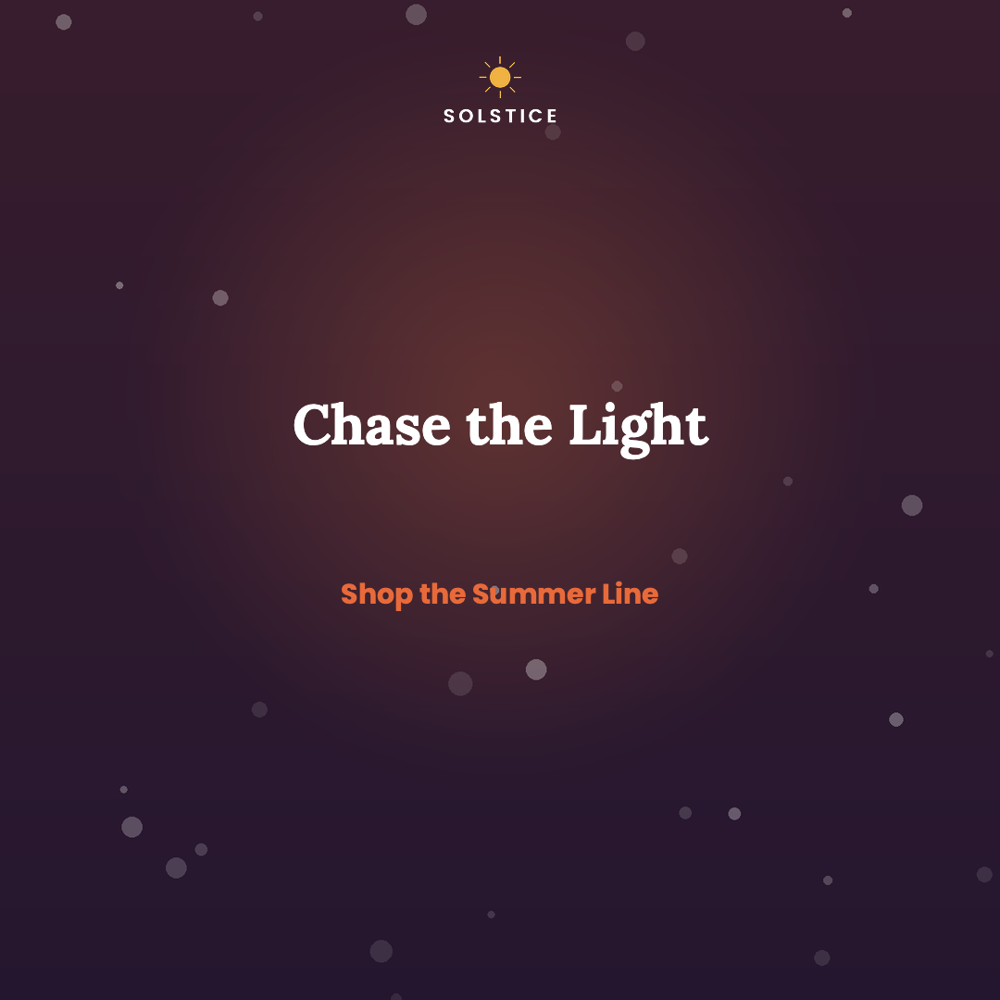
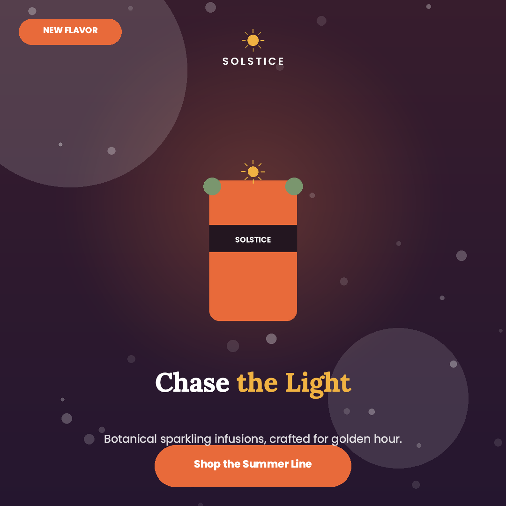
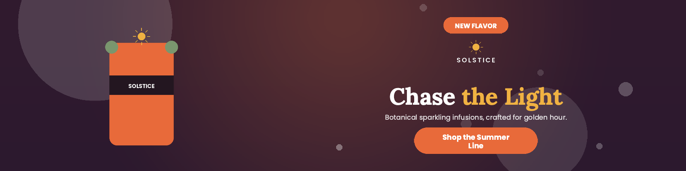
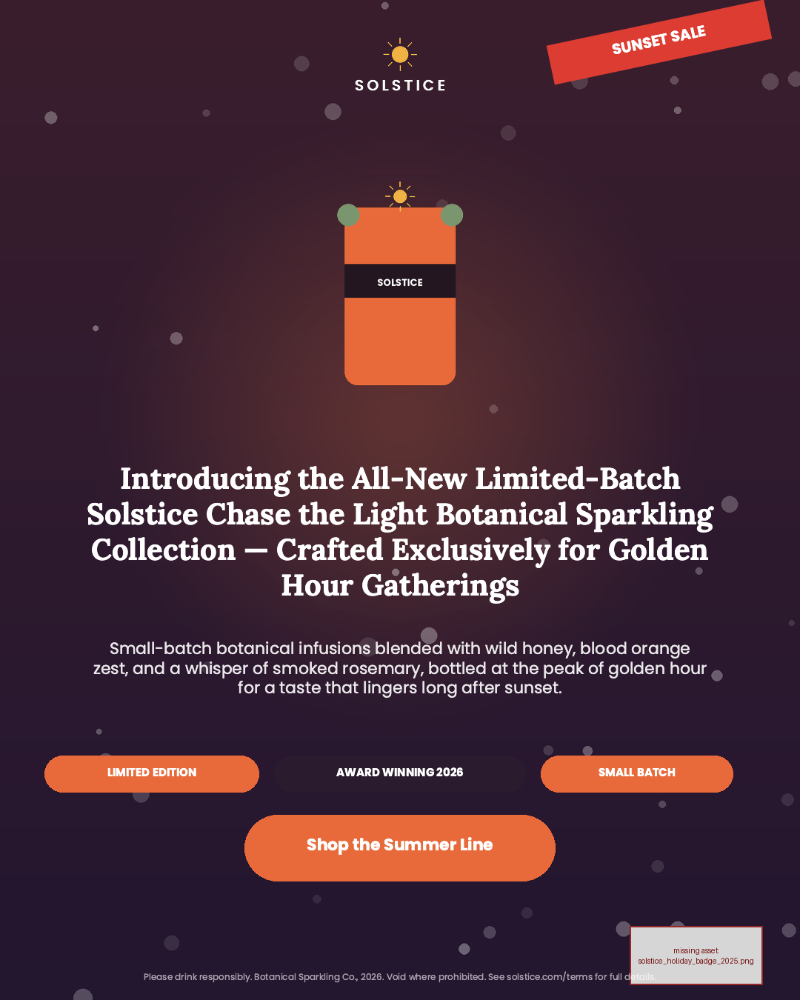

# CHAMELEON

**Resize a finished design to any canvas by rearranging it, not stretching it.**

Give it a design (text, images, shapes) and a new size. It returns the same
design with the same elements, words and pictures, repositioned and rescaled so
it still looks like the designer's work.

| | original | our resize |
|---|---|---|
| Square → portrait |  |  |
| Square → banner |  |  |
| Portrait → 728×90 strip |  |  |

---

## Run it

You need Python 3.11 (3.12 and 3.13 also work) and an internet connection for
the first run.

```bash
git clone git@github.com:PrompGibbons825/Adobe.git
cd Adobe
git checkout engine-v1
./setup.sh
```

This takes about a minute. It installs everything, downloads about 150 MB of
model files once, and resizes the three sample designs. Open the PNGs in
`output/` to see the results.

- The first design takes about 30 seconds (one-time warm-up). After that, each takes 1–2 seconds.
- The Level 2 sample prints two `off-canvas` warnings. That is expected: its two decorative circles bleed off the edge on purpose.

**Your own design:** put a task JSON in `input/` (format: see the samples and
`chameleon_design_schema_v0.9.json`), then run:

```bash
.venv/bin/python -m engine.main
```

**Docker (how it is scored):**

```bash
docker build --platform linux/amd64 -t my-chameleon-engine .
docker run --rm --network none -v $(pwd)/input:/app/input -v $(pwd)/output:/app/output my-chameleon-engine
```

**Something broke?**

| Problem | Fix |
|---|---|
| `rapidocr-onnxruntime` won't install on Python 3.13 | `./setup.sh` already handles it. Python 3.11 avoids it. |
| `CERTIFICATE_VERIFY_FAILED` downloading models | Re-run `./setup.sh`. It falls back to your system `curl`. |
| Output PNGs are plain labelled boxes | The renderer didn't install. Check `pip install` finished (it needs `git` and a network connection). |

Run with `CHAMELEON_DEBUG=1` to see every candidate layout and its score.

---

## How it works

The input is just boxes, fonts and asset names, with no labels. So the engine
first works out what everything is, then tries many layouts and picks the best.

1. **Analyze.** Work out each element's role (headline, logo, button, photo, badges, fine print, decoration) and which elements belong together. Find faces and the subject in photos.
2. **Propose.** Build 10–40 candidate layouts: refit the original, stack, split, panel, one row, columns, or, for extreme strips, turn the whole design.
3. **Finalize.** Crop background photos around the subject (never across eyes), place decoration, keep everything on the canvas, and enforce a minimum readable type size.
4. **Critique.** Score each candidate against our model of the judge's rubric. Then render the top ones and check with OCR that the headline and button still read.
5. **Build.** Output schema-valid JSON. No image is ever stretched, and any error falls back to a plain proportional scale, so a run never crashes.

Three rules shape everything:

- **Faithful first.** The designer's arrangement is kept unless a rebuilt layout is clearly better. The more extreme the size change, the more freedom to restructure.
- **Nothing invented.** Same element ids, same words, same pictures. Images are only cropped or scaled, never redrawn.
- **It has to read.** We check by rendering and running OCR, not just by arithmetic.

It is about 6,000 lines of Python, runs on CPU, and works fully offline.
**[Read the in-depth walkthrough →](docs/HOW_IT_WORKS.md)**

---

## Tradeoffs we made

| Decision | Why | What it costs |
|---|---|---|
| **Classical analysis plus small offline models**, no generative or large model | Image regeneration is disqualifying, scoring is offline, and speed counts. Every choice is inspectable. | It can't "understand" a design like a person. Unusual designs can be misread. |
| **Try many layouts, let our critic choose** | No single template wins everywhere. | The critic is hand-tuned and can overfit. |
| **Keep the original's look for standard formats** | The rubric rewards faithfulness. A recognisable, clean refit is safer than a clever rebuild. | Conservative when the original is mediocre at the new shape. |
| **Restructure only for extreme shape changes** | A square can't become a 12:1 strip without rows or turned text, but an ordinary portrait↔landscape change should stay upright. | Strip layouts differ from the source, and the type is small. |
| **Crop or fit pictures, never stretch. Eyes come first.** | Distortion and a card across someone's eyes are the first things a judge notices. | Crops are sometimes more cautious than a designer's. |
| **Words are fixed, only size and line breaks change** | The rules treat text and fonts as fixed for stage one. | Hand-wrapped paragraphs can lose their old line breaks (`CHAMELEON_UNWRAP=0` turns this off). |
| **OCR as a veto, not a score** | The judge is an AI looking at the picture, so we check by reading it. | OCR is slow, so only the top few are checked. |
| **Tiered critic and learned subject mask are built but off** | Not yet reliable. They flipped choices on unrelated designs. | We leave their gains unused for now. |
| **Quality over speed** | The rules don't penalise slow, good results. | 1–2 s per design, not real-time. |

**[Read the full reasoning for each decision →](docs/TRADEOFFS.md)**

---

## Hackathon rules

| Rule | How we meet it |
|---|---|
| Same element ids, nothing added or removed | Every id returns once, checked by `self_check` in `main.py`. |
| Nothing off-canvas | Everything is clamped to the canvas. |
| Images in proportion, never regenerated | Crop or fit only. No generative model anywhere. |
| Text and font family fixed | Never rewritten. |
| Offline (`--network none`) | Models are in git, in the pip wheel, or fetched at Docker build time. |
| Public weights if fine-tuned | We fine-tune nothing. |

## Known limitations

- **Two cases where an element is not shown.** A piece that was entirely off the source canvas, and an image whose asset file is missing, stay in the JSON (so the id check passes) but are set to invisible. The one real case is the Level 3 sample's deliberately missing `holiday_watermark`. If the rules forbid any hidden element, this is the place to change.
- **Extreme strips are hard.** The 728×90 output is legible but small, and our own critic rates its readability poorly.
- **The critic is hand-tuned**, and role detection is heuristic.
- **Some code comments are stale.** The header of `engine/resize.py` still mentions "drop levels". The engine no longer drops anything except the two cases above.

---

## More

- [How it works, in depth](docs/HOW_IT_WORKS.md): the pipeline stage by stage, with file pointers, the repo map and all settings
- [Tradeoffs in full](docs/TRADEOFFS.md): the reasoning and cost of each decision
- [TESTING.md](TESTING.md): held-out tests and comparison tools
- [RULES.md](RULES.md), [FAQ.md](FAQ.md): the hackathon rules

**Credits:** [cr-renderer](https://github.com/CyberAgentAILab/cr-renderer)
(CyberAgent AI Lab), YuNet face detection, CLIP ViT-B/32, PP-OCRv4 via RapidOCR,
and Crello designs for testing.
